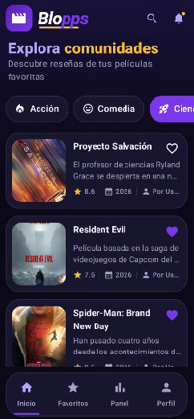
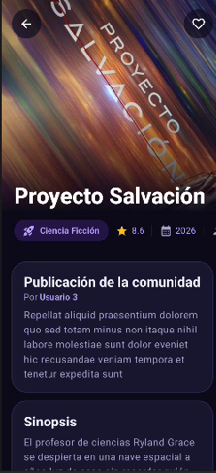
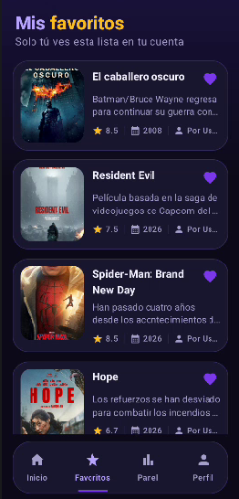
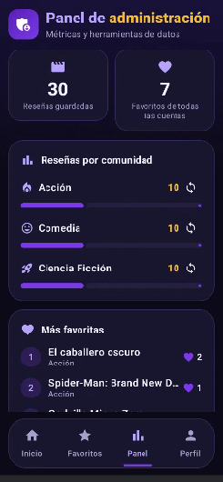
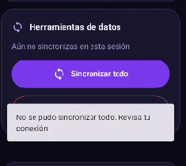

# Blopps

**Blopps** es una aplicación Android que funciona como un blog de reseñas de películas organizado por comunidades: **Acción**, **Comedia** y **Ciencia Ficción**. Las personas inician sesión, navegan las publicaciones de cada comunidad, abren el detalle, marcan favoritas y escriben reseñas. Quienes tienen rol administrador acceden además a un panel.

Proyecto del curso **Programación en Móviles** (Laboratorio N° 12: MVVM, Room, Retrofit, Firebase).

## Capturas

| Inicio de sesión |     Comunidades     | Detalle |
|:----------------:|:-------------------:| :---: |
|       |  |  |

|             Favoritos              | Panel Admin | Sin conexión / Error |
|:----------------------------------:| :---: | :---: |
|  |  |  |

## Funcionalidades

| Funcionalidad | Usuario | Admin |
| :--- | :---: | :---: |
| Iniciar sesión con correo y contraseña | Sí | Sí |
| Navegar por comunidades | Sí | Sí |
| Ver lista y detalle de publicaciones | Sí | Sí |
| Marcar y desmarcar favoritas, ver Favoritos | Sí | Sí |
| Leer y publicar reseñas | Sí | Sí |
| Cerrar sesión | Sí | Sí |
| Panel Admin: métricas, sincronizar y limpiar caché | No | Sí |

Además:
- **Modo sin conexión:** si falla la red se muestran los datos guardados con un aviso. Si no hay nada guardado, aparece el error con el botón **Reintentar**.
- **Notificación local** al terminar de sincronizar («Se guardaron N elementos»), con canal y permiso `POST_NOTIFICATIONS`. Al tocarla se abre la app. Si se niega el permiso, la app funciona con normalidad sin avisos.
- **Sesión persistente** al reabrir la app.

## Fuentes de datos

- **Base: [JSONPlaceholder](https://jsonplaceholder.typicode.com/) (Publicaciones).** Pública, sin clave y de solo lectura.
    - Lista por comunidad: `GET /posts?userId={n}`
    - Detalle: `GET /posts/{id}`
- **Capa adicional: [TMDB](https://www.themoviedb.org/)** (opcional). Aporta póster, calificación, año y director de la película reseñada.
    - Lista por género: `GET /discover/movie?with_genres={id}`
    - Detalle con créditos: `GET /movie/{id}?append_to_response=credits`

| Comunidad | Usuario de JSONPlaceholder | Género de TMDB |
| :--- | :---: | :---: |
| Acción | 1 | 28 |
| Comedia | 2 | 35 |
| Ciencia Ficción | 3 | 878 |

JSONPlaceholder no conoce películas, así que la publicación número *k* de una comunidad se asocia con la película número *k* del género correspondiente. El vínculo se guarda en Room, por lo que es estable entre sincronizaciones. **Si TMDB no está disponible o no hay clave, la app funciona igual** y muestra las publicaciones sin póster ni calificación.

> Este producto usa la API de TMDB pero no está avalado ni certificado por TMDB.

## Arquitectura

Patrón **MVVM** con **Room como fuente única de verdad**. Un composable nunca llama a Retrofit, Room ni Firebase: todo pasa por el ViewModel y el Repository.

| Capa | Responsabilidad |
| :--- | :--- |
| `ui` | Pantallas Compose y ViewModels. Observan `UiState` y notifican eventos. |
| `domain` | Modelos de dominio (`Publicacion`, `PeliculaInfo`, `Comunidad`, `Sesion`, `Rol`, `Resena`). |
| `data` | Retrofit (remoto), Room (local), Firebase (auth y reseñas), repositorios y mappers. |
| `notification` | Interface `Notificador` e implementación con `NotificationCompat`. |

```text
app/src/main/java/com/lajara/blopps/
├── MainActivity.kt / BloppsApp.kt / AppContainer.kt
├── data/
│   ├── remote/      Retrofit: PublicacionApiService, MovieApiService, DTO
│   ├── local/       Room: entidades, DAO y AppDatabase
│   ├── auth/        AuthRepository y FirebaseAuthRepository
│   ├── repository/  Repositorios (interfaces e implementaciones)
│   └── mapper/      DTO ↔ entidad ↔ modelo
├── domain/model/
├── notification/
└── ui/              navigation, login, comunidades, detalle, favoritos, admin, perfil, components, theme
```

Flujo de sincronización (`refrescar`):
1. Se piden las publicaciones de la comunidad a JSONPlaceholder.
2. Se guardan en Room con `Upsert`; los favoritos viven en una tabla aparte, por lo que no se pierden.
3. Si hay clave de TMDB, se asocian las películas del género y se guardan en columnas opcionales.
4. La interfaz, que observa Room, se actualiza sola y se muestra la notificación local.

## Tecnologías

Kotlin · Jetpack Compose · Material 3 · Navigation Compose · Retrofit + kotlinx-serialization · Room (KSP) · Firebase Authentication · Cloud Firestore · Coil · Coroutines y Flow · JUnit.

## Mejoras con IA (Fase 2)

Se han incorporado las siguientes mejoras avanzadas en la aplicación:

1. **Creación de publicaciones de usuarios con TMDB:** Los usuarios pueden crear reseñas propias buscando películas oficiales directamente desde la API de TMDB.
2. **Sistema social en tiempo real:** Comentarios en hilos (con respuestas de un solo nivel y manejo de huérfanos), "me gusta" instantáneos y cálculo de calificación promedio comunitaria.
3. **Rediseño visual (UI/UX) y animaciones:** Interfaz pulida con Material 3, tarjetas inmersivas, efecto shimmer de carga, FAB con scroll reactivo y transiciones de navegación fluidas.

### Arquitectura de las Nuevas Funcionalidades
- **Independencia de Room:** Las publicaciones de usuarios (`PublicacionUsuario`) no tocan Room; se gestionan de manera independiente a través de Cloud Firestore utilizando repositorios dedicados (`PublicacionUsuarioRepository`, `SocialRepository`) y ViewModels específicos (`CrearPublicacionViewModel`, `DetallePublicacionUsuarioViewModel`, `SocialViewModel`).
- **Estructura de Firestore:**
  - `publicaciones_usuarios/{id}`: `comunidad`, `autorUid`, `autorCorreo`, `titulo`, `resena`, `calificacion`, `peliculaId`, `peliculaTitulo`, `posterUrl`, `anio`, `fecha`.
  - `publicaciones_usuarios/{id}/comentarios/{comentarioId}`: `autorUid`, `autorCorreo`, `texto`, `fecha`, `respuestaA`.
  - `publicaciones_usuarios/{id}/votos/{uid}`: `valor` (1..5).
  - `publicaciones_usuarios/{id}/likes/{uid}`: `existe` (true).
- **Despliegue de Reglas de Seguridad:** Las reglas de Cloud Firestore se encuentran en el archivo `firestore.rules` en la raíz del proyecto y deben copiarse y publicarse en la consola de Firebase (Firestore Database → Reglas).
- **TMDB Opcional:** La búsqueda de películas requiere `TMDB_API_KEY` en `local.properties`. Si no se provee, la app degrada la funcionalidad de búsqueda de forma limpia sin afectar el resto de la aplicación.
- **Ejecución de Pruebas:** El proyecto cuenta con un conjunto amplio de 42 pruebas unitarias (incluyendo validaciones, armado de hilos, repositorios y ViewModels) que se ejecutan con:
  ```bash
  ./gradlew test
  ```

## Cómo ejecutar el proyecto

**Requisitos:** Android Studio reciente, JDK 11 o superior y un dispositivo o emulador con Android 7.0 (API 24) o superior.

1. Clona el repositorio:
   ```bash
   git clone https://github.com/mtl-124/Blopps.git
   ```
2. **Firebase:** descarga `google-services.json` desde la consola de Firebase (Configuración del proyecto → General → app Android `com.lajara.blopps`) y colócalo en `app/`. Activa **Authentication** (correo y contraseña) y **Firestore**.
3. **Roles:** en Firestore, el documento `usuarios/{uid}` tiene el campo `rol` con valor `admin` o `usuario`. Cualquier otro valor se trata como `usuario`. El rol se asigna desde la consola de Firebase, no desde la app.
4. **TMDB (opcional):** crea una clave gratuita en [themoviedb.org](https://www.themoviedb.org/settings/api) y agrégala a `local.properties`:
   ```properties
   TMDB_API_KEY=tu_clave
   ```
5. Sincroniza Gradle y ejecuta la app.

`google-services.json` y `local.properties` están en `.gitignore` y no se suben al repositorio.

## Pruebas

Pruebas unitarias ejecutadas con JUnit y Coroutines Test:

```bash
./gradlew test
```

## Autor

Proyecto individual de **Gael Matteo La Jara Barboza** (`mtl-124`) — Programación en Móviles, Diseño y Desarrollo de Software.
